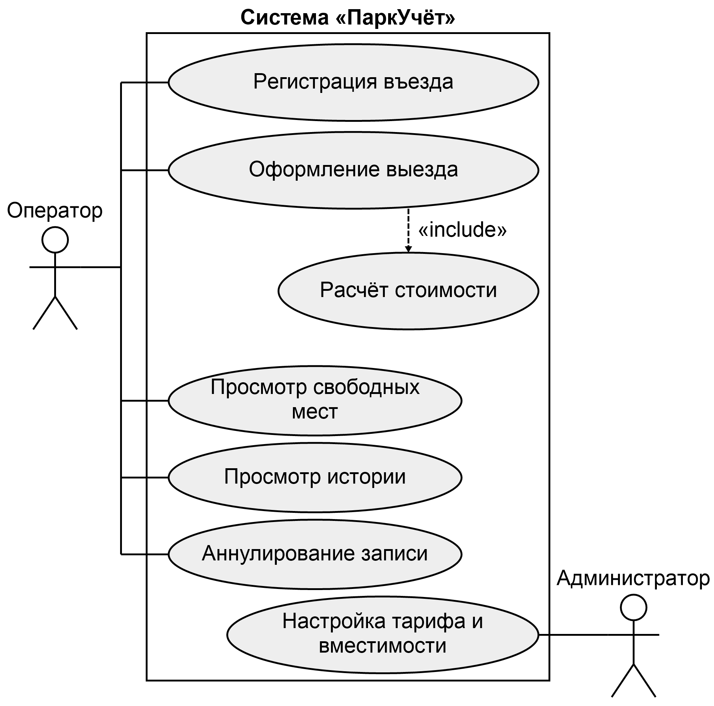
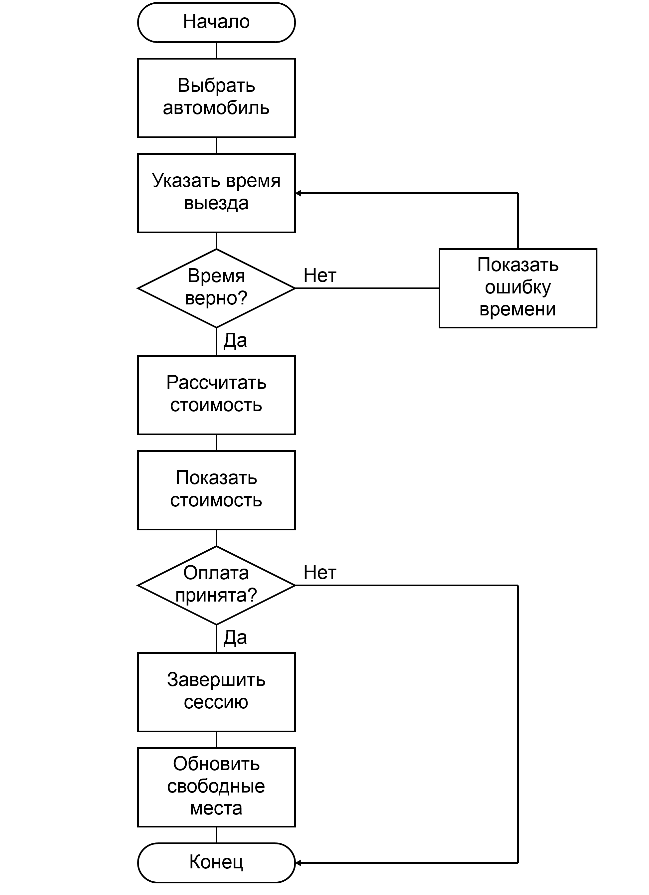
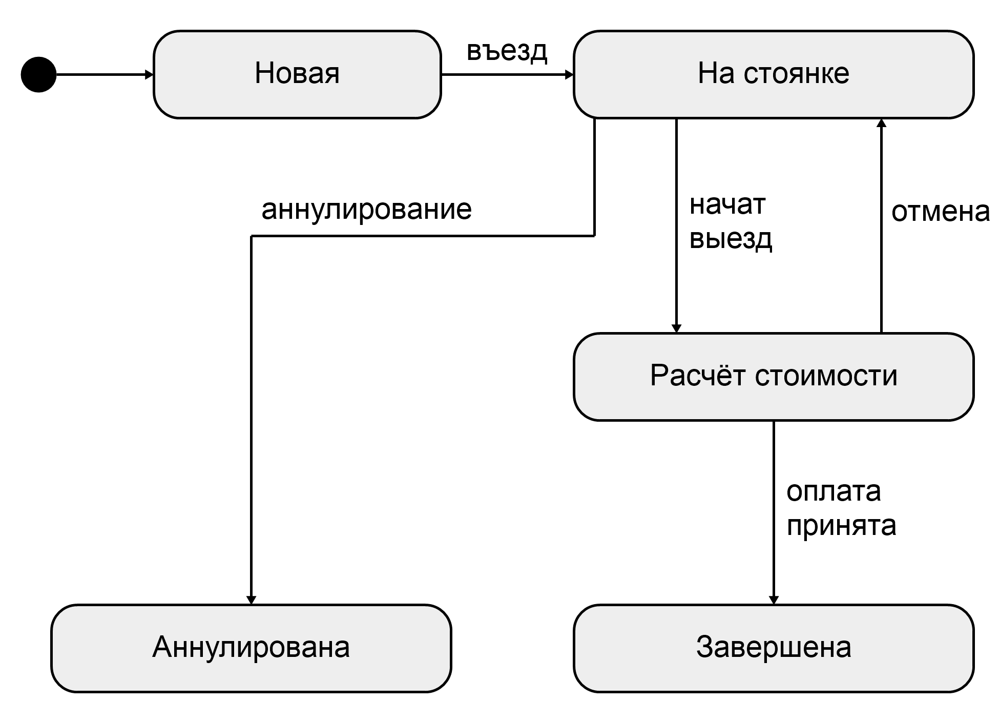
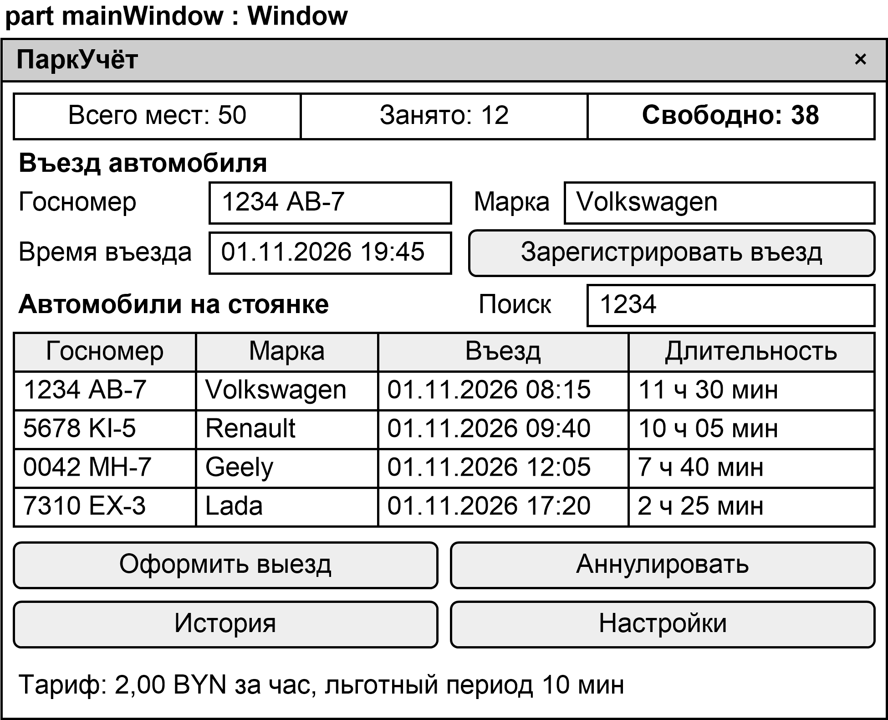
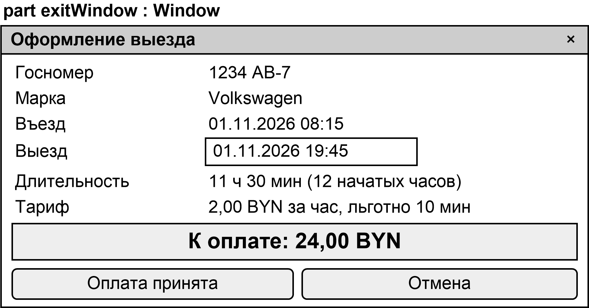
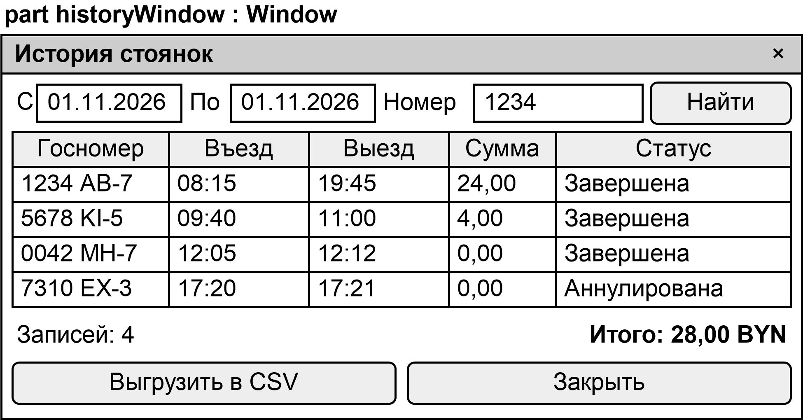
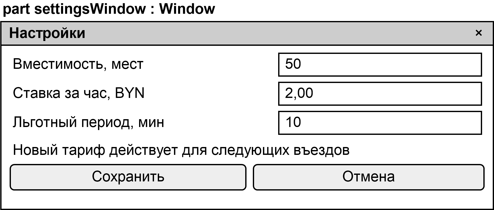

# Спецификация требований к ПО

Для «ПаркУчёт» – системы учёта автомобилей на платной автостоянке

Версия 0.1

Подготовил(а) Кузьминчук М. Ю., гр. 434701

БГУИР, факультет компьютерных систем и сетей, кафедра электронных вычислительных машин

2026-11-01

## Оглавление

<!-- TOC -->
* [1. Введение](#1-introduction)
  * [1.1 Назначение документа](#11-document-purpose)
  * [1.2 Область применения продукта](#12-product-scope)
  * [1.3 Определения, акронимы и сокращения](#13-definitions-acronyms-and-abbreviations)
  * [1.4 Ссылки](#14-references)
  * [1.5 Обзор документа](#15-document-overview)
* [2. Обзор продукта](#2-product-overview)
  * [2.1 Перспектива продукта](#21-product-perspective)
  * [2.2 Функции продукта](#22-product-functions)
  * [2.3 Ограничения продукта](#23-product-constraints)
  * [2.4 Характеристики пользователей](#24-user-characteristics)
  * [2.5 Допущения и зависимости](#25-assumptions-and-dependencies)
  * [2.6 Распределение требований](#26-apportioning-of-requirements)
* [3. Требования](#3-requirements)
  * [3.1 Внешние интерфейсы](#31-external-interfaces)
    * [3.1.1 Пользовательские интерфейсы](#311-user-interfaces)
    * [3.1.2 Аппаратные интерфейсы](#312-hardware-interfaces)
    * [3.1.3 Программные интерфейсы](#313-software-interfaces)
  * [3.2 Функциональные требования](#32-functional)
  * [3.3 Качество обслуживания](#33-quality-of-service)
    * [3.3.1 Производительность](#331-performance)
    * [3.3.2 Безопасность](#332-security)
    * [3.3.3 Надёжность](#333-reliability)
    * [3.3.4 Доступность](#334-availability)
    * [3.3.5 Наблюдаемость](#335-observability)
  * [3.4 Соответствие стандартам](#34-compliance)
  * [3.5 Проектирование и реализация](#35-design-and-implementation)
    * [3.5.1 Установка](#351-installation)
    * [3.5.2 Сборка и поставка](#352-build-and-delivery)
    * [3.5.3 Распределение](#353-distribution)
    * [3.5.4 Сопровождаемость](#354-maintainability)
    * [3.5.5 Повторное использование](#355-reusability)
    * [3.5.6 Переносимость](#356-portability)
    * [3.5.7 Стоимость](#357-cost)
    * [3.5.8 Сроки](#358-deadline)
    * [3.5.9 Доказательство концепции](#359-proof-of-concept)
    * [3.5.10 Управление изменениями](#3510-change-management)
  * [3.6 ИИ/МО](#36-aiml)
    * [3.6.1 Спецификация модели](#361-model-specification)
    * [3.6.2 Управление данными](#362-data-management)
    * [3.6.3 Ограничители (Guardrails)](#363-guardrails)
    * [3.6.4 Этика](#364-ethics)
    * [3.6.5 Human-in-the-Loop](#365-human-in-the-loop)
    * [3.6.6 Жизненный цикл модели и операции](#366-model-lifecycle-and-operations)
* [4. Верификация](#4-verification)
* [5. Приложения](#5-appendixes)
<!-- TOC -->

## История изменений

Таблица 1 – История изменений

| Автор | Дата | Причина изменения | Версия |
|------|------|--------------------|---------|
| Кузьминчук М. Ю. | 2026-11-01 | Первая редакция по бизнес-требованиям Заказчика | 0.1 |

---

## 1. Введение {#1-introduction}

Документ задаёт требования к настольному приложению «ПаркУчёт», которое автоматизирует работу оператора платной автостоянки: регистрацию въезда, расчёт стоимости при выезде, показ свободных мест и ведение истории.

### 1.1 Назначение документа {#11-document-purpose}

Спецификация определяет, что должна делать система, и не предписывает, как её реализовать, кроме ограничений раздела 2.3. Документ используют Заказчик – для согласования состава работ, разработчик – для проектирования и реализации на языке C++, проверяющий – для составления тестов и приёмки. Требования служат исходными данными для описания архитектуры (каталог sdd) и записей архитектурных решений (каталог adr).

### 1.2 Область применения продукта {#12-product-scope}

Продукт – «ПаркУчёт», версия 1.0. Приложение заменяет бумажный журнал стоянки. Оператор вносит госномер, марку и время въезда, а при выезде программа рассчитывает стоимость по действующему тарифу, показывает количество свободных мест и сохраняет завершённые стоянки в истории.

Бизнес-цели продукта:

- БЦ-1 – исключить ошибки ручного расчёта стоимости стоянки;
- БЦ-2 – всегда знать количество свободных мест, чтобы не принимать автомобили сверх вместимости;
- БЦ-3 – сократить время оформления одного автомобиля;
- БЦ-4 – хранить проверяемую историю стоянок и сумм за любой период.

В область продукта входят: учёт автомобилей на одной стоянке, настройка тарифа и вместимости, поиск и выгрузка истории.

В область продукта не входят: приём платежей и печать кассовых чеков, управление шлагбаумом, распознавание номеров камерой, бронирование мест, абонементы, учёт нескольких стоянок, закрепление за автомобилем конкретного номера места.

### 1.3 Определения, акронимы и сокращения {#13-definitions-acronyms-and-abbreviations}

Таблица 2 – Глоссарий

| Термин | Определение |
|------|------------|
| Вместимость | Общее количество мест на стоянке, задаётся администратором |
| Госномер | Государственный регистрационный знак автомобиля, например 1234 AB-7 |
| Льготный период | Время от въезда, в пределах которого стоянка не оплачивается |
| Свободные места | Разность вместимости и количества автомобилей на стоянке |
| Сессия стоянки | Запись об одном пребывании автомобиля от въезда до выезда |
| Тариф | Ставка за час и длительность льготного периода |
| BYN | Белорусский рубль |
| CSV | Текстовый формат таблиц со значениями, разделёнными точкой с запятой |
| SRS | Спецификация требований к программному обеспечению |
| SysML | Язык системного моделирования |

### 1.4 Ссылки {#14-references}

Таблица 3 – Ссылки

| Документ | Расположение | Статус |
|------|------------|------|
| ISO/IEC/IEEE 29148:2018, инженерия требований | docs/standards.md | Нормативный |
| Закон Республики Беларусь № 99-З «О защите персональных данных» | Национальный правовой портал | Нормативный |
| Шаблон спецификации требований | srs/srs-template.md | Нормативный |
| Модель системы и макеты на SysML v2 | srs/sysml/ | Справочный |
| Изображения макетов и диаграмм | srs/images/ | Справочный |

### 1.5 Обзор документа {#15-document-overview}

Раздел 2 описывает контекст продукта, раздел 3 – проверяемые требования, раздел 4 – способы их проверки, раздел 5 – словарь данных и открытые вопросы. Слово «должна» обозначает обязательное требование, «следует» – желательное. Любое изменение увеличивает версию документа и отражается в истории изменений.

---

## 2. Обзор продукта {#2-product-overview}

### 2.1 Перспектива продукта {#21-product-perspective}

«ПаркУчёт» – новый самостоятельный продукт, он не входит в более крупную систему и не обменивается данными с внешними сервисами. Приложение работает на одном компьютере в будке оператора. Участники и варианты использования показаны на рисунке 1.

### 2.2 Функции продукта {#22-product-functions}

Основные функции продукта:

- регистрация въезда автомобиля с указанием госномера, марки и времени;
- оформление выезда и расчёт стоимости стоянки по тарифу;
- показ вместимости, занятых и свободных мест;
- показ автомобилей, находящихся на стоянке;
- ведение истории стоянок, поиск и итоговая сумма за период;
- настройка тарифа и вместимости;
- аннулирование ошибочной записи о въезде.

Последовательность оформления выезда показана на рисунке 2, состояния сессии стоянки – на рисунке 3.

### 2.3 Ограничения продукта {#23-product-constraints}

- ОГР-1 – приложение должно быть написано на языке C++ стандарта C++17;
- ОГР-2 – приложение должно работать в операционных системах Windows 10 и Windows 11 разрядности 64 бита;
- ОГР-3 – приложение должно работать без подключения к сети Интернет;
- ОГР-4 – интерфейс должен быть на русском языке;
- ОГР-5 – денежные суммы должны указываться в белорусских рублях с двумя знаками после запятой;
- ОГР-6 – в продукте не должны использоваться компоненты с платными лицензиями.

### 2.4 Характеристики пользователей {#24-user-characteristics}

Таблица 4 – Классы пользователей

| Класс пользователя | Задача | Подготовка | Частота работы |
|------|------|------|------|
| Оператор | Оформляет въезд и выезд, смотрит историю | Начальные навыки работы с компьютером | Постоянно в течение смены |
| Администратор | Задаёт тариф и вместимость | Уверенный пользователь | Несколько раз в год |

### 2.5 Допущения и зависимости {#25-assumptions-and-dependencies}

Допущения приняты разработчиком и подлежат подтверждению Заказчиком (см. раздел 5).

Таблица 5 – Допущения

| Обозначение | Допущение | Последствие, если допущение неверно |
|------|------|------|
| Д-1 | Одна стоянка и одно рабочее место оператора | Потребуется общая база данных и работа по сети |
| Д-2 | Тариф состоит из ставки за час и льготного периода | Потребуется изменить расчёт стоимости |
| Д-3 | Оператор принимает оплату вне программы | Потребуется подключение кассового оборудования |
| Д-4 | Учитывается только количество мест, а не их номера | Потребуется план стоянки и выбор места |
| Д-5 | Системные часы компьютера идут верно | Неверное время приведёт к неверной стоимости |

### 2.6 Распределение требований {#26-apportioning-of-requirements}

Таблица 6 – Распределение требований по версиям

| Версия | Требование |
|------|------|
| 1.0 | REQ-FUNC-001 – REQ-FUNC-015 и все требования разделов 3.1, 3.3 – 3.5 |
| 1.1 | REQ-FUNC-016 |

---

## 3. Требования {#3-requirements}

Идентификаторы имеют вид REQ-[AREA]-[NNN]. Изменение требования фиксируется в истории изменений, идентификаторы повторно не используются.

### 3.1 Внешние интерфейсы {#31-external-interfaces}

#### 3.1.1 Пользовательские интерфейсы {#311-user-interfaces}

Макеты экранов описаны на языке SysML v2 в файле srs/sysml/ui-mockups.sysml и показаны на рисунках 4 – 7.

- **ID:** REQ-INT-001
- **Title:** Состав окон
- **Statement:** Система должна предоставлять главное окно, окно оформления выезда, окно истории и окно настроек, соответствующие макетам.
- **Rationale:** Заказчик согласует внешний вид до начала разработки.
- **Acceptance Criteria:** Все элементы макетов присутствуют в приложении.
- **Verification Method:** Inspection

- **ID:** REQ-INT-002
- **Title:** Работа с клавиатуры
- **Statement:** Система должна позволять выполнять оформление въезда и выезда без мыши.
- **Rationale:** Оператор вводит данные с клавиатуры, глядя на автомобиль.
- **Acceptance Criteria:** Клавиша Tab переводит фокус между полями, Enter выполняет основное действие окна, Esc закрывает окно без сохранения.
- **Verification Method:** Demonstration

- **ID:** REQ-INT-003
- **Title:** Сообщения об ошибках
- **Statement:** При неверном вводе система должна показывать сообщение на русском языке с названием поля и причиной отказа, сохраняя уже введённые данные.
- **Rationale:** Оператор должен сразу понимать, что исправить.
- **Acceptance Criteria:** Для каждого условия отказа из раздела 3.2 выводится отдельное сообщение, поля не очищаются.
- **Verification Method:** Test

#### 3.1.2 Аппаратные интерфейсы {#312-hardware-interfaces}

- **ID:** REQ-INT-004
- **Title:** Оборудование
- **Statement:** Система должна работать на компьютере с клавиатурой, мышью и монитором с разрешением не менее 1280×720 точек и не должна требовать другого оборудования.
- **Rationale:** На стоянке используется обычный офисный компьютер.
- **Acceptance Criteria:** При разрешении 1280×720 точек все элементы окон видны без обрезания.
- **Verification Method:** Inspection

#### 3.1.3 Программные интерфейсы {#313-software-interfaces}

- **ID:** REQ-INT-005
- **Title:** Отсутствие внешних сервисов
- **Statement:** Система не должна обращаться к внешним сетевым сервисам.
- **Rationale:** Данные хранятся только на компьютере стоянки (ОГР-3).
- **Acceptance Criteria:** Все функции работают при отключённой сети, сетевых соединений приложение не создаёт.
- **Verification Method:** Test

- **ID:** REQ-INT-006
- **Title:** Формат выгрузки
- **Statement:** Файл выгрузки истории должен быть в формате CSV в кодировке UTF-8 с разделителем «точка с запятой» и строкой заголовков.
- **Rationale:** Файл открывается в табличном редакторе без настройки.
- **Acceptance Criteria:** Выгруженный файл открывается в Microsoft Excel, кириллица отображается верно.
- **Verification Method:** Test

### 3.2 Функциональные требования {#32-functional}

- **ID:** REQ-FUNC-001
- **Title:** Регистрация въезда
- **Statement:** Система должна по команде оператора создавать сессию стоянки с госномером, маркой и временем въезда.
- **Rationale:** Основная операция учёта, указанная Заказчиком.
- **Acceptance Criteria:** После регистрации автомобиль появляется в списке на стоянке, количество свободных мест уменьшается на единицу, запись сохраняется после перезапуска.
- **Verification Method:** Test

- **ID:** REQ-FUNC-002
- **Title:** Время въезда по умолчанию
- **Statement:** Система должна подставлять в поле времени въезда текущее время компьютера с точностью до минуты и разрешать оператору его изменить.
- **Rationale:** Обычно автомобиль оформляют сразу, но возможно и оформление с опозданием.
- **Acceptance Criteria:** При открытии формы поле содержит текущее время, значение можно изменить вручную.
- **Verification Method:** Demonstration

- **ID:** REQ-FUNC-003
- **Title:** Проверка данных въезда
- **Statement:** Система должна отклонять въезд, если госномер содержит менее двух или более 12 знаков или знаки, кроме букв, цифр, пробела и дефиса, если марка содержит менее одного или более 30 знаков, если время въезда позже текущего.
- **Rationale:** Неверные данные делают невозможным поиск и расчёт.
- **Acceptance Criteria:** Каждое из условий приводит к отказу и сообщению. Госномер сохраняется прописными буквами.
- **Verification Method:** Test

- **ID:** REQ-FUNC-004
- **Title:** Запрет повторного въезда
- **Statement:** Система должна отклонять въезд автомобиля, госномер которого совпадает с госномером автомобиля на стоянке.
- **Rationale:** Один автомобиль не может находиться на стоянке дважды, повтор означает ошибку ввода.
- **Acceptance Criteria:** При повторном вводе выводится сообщение, новая сессия не создаётся. Сравнение не зависит от регистра букв.
- **Verification Method:** Test

- **ID:** REQ-FUNC-005
- **Title:** Запрет въезда при отсутствии мест
- **Statement:** Система должна отклонять въезд при нуле свободных мест.
- **Rationale:** Нельзя принимать автомобили сверх вместимости (БЦ-2).
- **Acceptance Criteria:** При нуле свободных мест выводится сообщение «Свободных мест нет», сессия не создаётся.
- **Verification Method:** Test

- **ID:** REQ-FUNC-006
- **Title:** Оформление выезда
- **Statement:** Система должна по выбранному автомобилю показывать время въезда, время выезда, длительность стоянки, применённый тариф и стоимость.
- **Rationale:** Оператор называет водителю сумму и может её обосновать.
- **Acceptance Criteria:** Окно выезда содержит перечисленные значения, время выезда по умолчанию равно текущему, его можно изменить. Время выезда раньше времени въезда или позже текущего отклоняется.
- **Verification Method:** Test

- **ID:** REQ-FUNC-007
- **Title:** Расчёт стоимости
- **Statement:** Система должна рассчитывать стоимость стоянки по тарифу, действовавшему на момент въезда: если длительность не превышает льготный период, стоимость равна нулю, иначе стоимость равна произведению количества начатых часов на ставку за час.
- **Rationale:** Единое правило исключает спор с клиентом и ошибки ручного расчёта (БЦ-1).
- **Acceptance Criteria:** Результаты совпадают с контрольными примерами таблицы 7. Льготный период из оплачиваемого времени не вычитается.
- **Verification Method:** Test

Таблица 7 – Контрольные примеры расчёта при ставке 2,00 BYN за час и льготном периоде 10 мин

| Длительность, мин | Количество начатых часов | Стоимость, BYN |
|------|------|------|
| 0 | 0 | 0,00 |
| 10 | 0 | 0,00 |
| 11 | 1 | 2,00 |
| 60 | 1 | 2,00 |
| 61 | 2 | 4,00 |
| 135 | 3 | 6,00 |
| 1500 | 25 | 50,00 |

- **ID:** REQ-FUNC-008
- **Title:** Завершение стоянки
- **Statement:** Система должна при подтверждении оператором завершать сессию и переносить её в историю, а при отмене оставлять автомобиль на стоянке без изменений.
- **Rationale:** Расчёт ещё не означает, что автомобиль уехал и оплата принята.
- **Acceptance Criteria:** После подтверждения количество свободных мест увеличивается на единицу, запись появляется в истории. После отмены данные не меняются.
- **Verification Method:** Test

- **ID:** REQ-FUNC-009
- **Title:** Показ свободных мест
- **Statement:** Система должна постоянно показывать в главном окне вместимость, количество занятых и свободных мест.
- **Rationale:** Прямое требование Заказчика (БЦ-2).
- **Acceptance Criteria:** Свободные места всегда равны разности вместимости и количества автомобилей на стоянке, значения обновляются сразу после каждой операции.
- **Verification Method:** Test

- **ID:** REQ-FUNC-010
- **Title:** Список автомобилей на стоянке
- **Statement:** Система должна показывать автомобили на стоянке с госномером, маркой, временем въезда и текущей длительностью и искать их по части госномера.
- **Rationale:** Оператор должен быстро найти автомобиль при выезде.
- **Acceptance Criteria:** Список упорядочен по времени въезда, поиск оставляет только совпадающие строки.
- **Verification Method:** Test

- **ID:** REQ-FUNC-011
- **Title:** Ведение истории
- **Statement:** Система должна хранить завершённые и аннулированные сессии с госномером, маркой, временем въезда и выезда, длительностью, тарифом, стоимостью и статусом.
- **Rationale:** Прямое требование Заказчика (БЦ-4).
- **Acceptance Criteria:** Каждая завершённая сессия присутствует в истории и после перезапуска, средств изменения записей истории в интерфейсе нет.
- **Verification Method:** Test

- **ID:** REQ-FUNC-012
- **Title:** Поиск по истории
- **Statement:** Система должна отбирать записи истории по периоду и части госномера и показывать количество записей и итоговую сумму.
- **Rationale:** Владельцу нужно сверять выручку за смену и разбирать спорные случаи.
- **Acceptance Criteria:** Итог равен сумме стоимости показанных завершённых сессий, аннулированные сессии в сумму не входят.
- **Verification Method:** Test

- **ID:** REQ-FUNC-013
- **Title:** Настройка тарифа
- **Statement:** Система должна позволять администратору задавать ставку от 0,01 до 1000,00 BYN за час и льготный период от 0 до 60 мин.
- **Rationale:** Владелец стоянки меняет цены без участия разработчика.
- **Acceptance Criteria:** Значения вне диапазона отклоняются. Новый тариф применяется только к автомобилям, въехавшим после изменения.
- **Verification Method:** Test

- **ID:** REQ-FUNC-014
- **Title:** Настройка вместимости
- **Statement:** Система должна позволять администратору задавать вместимость от 1 до 10000 мест, но не меньше количества автомобилей на стоянке.
- **Rationale:** Стоянку могут расширить или временно сократить.
- **Acceptance Criteria:** Значение меньше количества автомобилей на стоянке отклоняется, количество свободных мест пересчитывается сразу.
- **Verification Method:** Test

- **ID:** REQ-FUNC-015
- **Title:** Аннулирование ошибочной записи
- **Statement:** Система должна позволять оператору аннулировать сессию автомобиля на стоянке с обязательным указанием причины.
- **Rationale:** Опечатку в госномере иначе нельзя исправить без искажения истории.
- **Acceptance Criteria:** Без причины операция отклоняется. После аннулирования место освобождается, запись попадает в историю со статусом «Аннулирована» и нулевой стоимостью.
- **Verification Method:** Test

- **ID:** REQ-FUNC-016
- **Title:** Выгрузка истории
- **Statement:** Системе следует выгружать отобранные записи истории в файл CSV.
- **Rationale:** Бухгалтерия обрабатывает данные в табличном редакторе.
- **Acceptance Criteria:** Количество строк файла равно количеству показанных записей плюс строка заголовков.
- **Verification Method:** Test
- **More Information:** Планируется в версии 1.1.

### 3.3 Качество обслуживания {#33-quality-of-service}

#### 3.3.1 Производительность {#331-performance}

- **ID:** REQ-PERF-001
- **Title:** Время отклика
- **Statement:** Операции въезда, расчёта и выезда должны выполняться не более чем за 1 с при 100000 записей в истории.
- **Rationale:** Очередь на въезд не должна ожидать программу (БЦ-3).
- **Acceptance Criteria:** Среднее по 100 замерам на компьютере с 4 ГБ оперативной памяти не превышает 1 с.
- **Verification Method:** Test

- **ID:** REQ-PERF-002
- **Title:** Время запуска
- **Statement:** Запуск приложения до готовности главного окна должен занимать не более 3 с.
- **Rationale:** Смена не должна начинаться с ожидания.
- **Acceptance Criteria:** Время запуска при 100000 записей в истории не превышает 3 с.
- **Verification Method:** Test

- **ID:** REQ-PERF-003
- **Title:** Трудоёмкость оформления
- **Statement:** Подготовленный оператор должен оформлять въезд не более чем за 30 с.
- **Rationale:** Показатель проверяет достижение цели БЦ-3.
- **Acceptance Criteria:** Среднее по десяти оформлениям не превышает 30 с.
- **Verification Method:** Demonstration

#### 3.3.2 Безопасность {#332-security}

- **ID:** REQ-SEC-001
- **Title:** Защита настроек
- **Statement:** Изменение тарифа и вместимости должно быть доступно только после ввода пароля администратора, пароль не должен храниться в открытом виде.
- **Rationale:** Оператор не должен менять цены.
- **Acceptance Criteria:** С неверным паролем окно настроек не открывается, в файлах приложения пароля в открытом виде нет.
- **Verification Method:** Test

- **ID:** REQ-SEC-002
- **Title:** Минимизация данных
- **Statement:** Система не должна запрашивать и хранить сведения о владельце автомобиля.
- **Rationale:** Сокращает объём данных, которые могут относиться к персональным (REQ-COMP-001).
- **Acceptance Criteria:** В окнах и файлах данных нет полей имени, телефона и документов владельца.
- **Verification Method:** Inspection

#### 3.3.3 Надёжность {#333-reliability}

- **ID:** REQ-REL-001
- **Title:** Сохранность при сбое
- **Statement:** Подтверждённая операция должна сохраняться до показа её результата, при аварийном завершении могут быть потеряны только неподтверждённые данные.
- **Rationale:** Потеря записи означает потерю денег и спор с клиентом.
- **Acceptance Criteria:** После принудительного завершения процесса сразу после подтверждения запись присутствует при следующем запуске, данные не повреждены.
- **Verification Method:** Test

- **ID:** REQ-REL-002
- **Title:** Резервная копия
- **Statement:** Система должна при запуске создавать копию данных, если последняя копия старше суток, и хранить не менее семи последних копий.
- **Rationale:** Отказ диска или повреждение файла не должны уничтожать историю.
- **Acceptance Criteria:** После запуска в каталоге копий появляется новая копия, старые копии сверх семи удаляются.
- **Verification Method:** Test

#### 3.3.4 Доступность {#334-availability}

- **ID:** REQ-AVAIL-001
- **Title:** Восстановление работы
- **Statement:** После сбоя компьютера оператор должен иметь возможность продолжить работу повторным запуском приложения, без дополнительных действий по восстановлению.
- **Rationale:** На стоянке нет технического специалиста.
- **Acceptance Criteria:** После перезапуска список автомобилей на стоянке совпадает с состоянием до сбоя.
- **Verification Method:** Test

#### 3.3.5 Наблюдаемость {#335-observability}

- **ID:** REQ-OBS-001
- **Title:** Журнал работы
- **Statement:** Система должна записывать в журнал время и вид каждой операции и ошибки, хранить его не менее 90 суток и не записывать в него пароль.
- **Rationale:** Журнал нужен для разбора спорных случаев и ошибок.
- **Acceptance Criteria:** Каждая операция въезда, выезда, аннулирования и изменения настроек отражается в журнале.
- **Verification Method:** Inspection

### 3.4 Соответствие стандартам {#34-compliance}

- **ID:** REQ-COMP-001
- **Title:** Персональные данные
- **Statement:** Обработка госномеров должна соответствовать Закону Республики Беларусь № 99-З, если госномер в сочетании с другими сведениями позволяет определить физическое лицо.
- **Rationale:** Нормативное требование, применимость уточняется у Заказчика.
- **Acceptance Criteria:** Выполнены требования REQ-SEC-002, в документации указаны цель и срок хранения данных.
- **Verification Method:** Inspection

- **ID:** REQ-COMP-002
- **Title:** Структура спецификации
- **Statement:** Спецификация требований должна соответствовать шаблону курса и ISO/IEC/IEEE 29148.
- **Rationale:** Требование дисциплины.
- **Acceptance Criteria:** Разделы документа совпадают с разделами шаблона.
- **Verification Method:** Inspection

### 3.5 Проектирование и реализация {#35-design-and-implementation}

#### 3.5.1 Установка {#351-installation}

- **ID:** REQ-INST-001
- **Title:** Установка копированием
- **Statement:** Приложение должно устанавливаться копированием каталога и не должно требовать прав администратора Windows.
- **Rationale:** Упрощает установку на компьютер стоянки.
- **Acceptance Criteria:** Приложение запускается из скопированного каталога под обычным пользователем, удаление каталога с данными полностью удаляет приложение.
- **Verification Method:** Demonstration

#### 3.5.2 Сборка и поставка {#352-build-and-delivery}

- **ID:** REQ-BUILD-001
- **Title:** Сборка
- **Statement:** Проект должен собираться из каталога project репозитория с помощью CMake, зависимости должны быть указаны с номерами версий.
- **Rationale:** Сборка должна быть воспроизводимой.
- **Acceptance Criteria:** Команды из файла README.md на чистой копии репозитория создают исполняемый файл.
- **Verification Method:** Demonstration

#### 3.5.3 Распределение {#353-distribution}

- **ID:** REQ-DIST-001
- **Title:** Размещение
- **Statement:** Приложение и его данные должны размещаться на одном компьютере.
- **Rationale:** Распределённая работа не требуется (Д-1).
- **Acceptance Criteria:** Для работы не требуются другие компьютеры и серверы.
- **Verification Method:** Inspection

#### 3.5.4 Сопровождаемость {#354-maintainability}

- **ID:** REQ-MAINT-001
- **Title:** Разделение логики и интерфейса
- **Statement:** Логика учёта и расчёта должна быть отделена от кода окон и покрыта автоматическими тестами.
- **Rationale:** Изменения требований Заказчика возможны на любом этапе (раздел 3.5.10).
- **Acceptance Criteria:** Модуль логики собирается и тестируется без графического интерфейса, все примеры таблицы 7 входят в тесты.
- **Verification Method:** Inspection

#### 3.5.5 Повторное использование {#355-reusability}

- **ID:** REQ-REUSE-001
- **Title:** Модуль тарифа
- **Statement:** Расчёт стоимости должен быть оформлен отдельным модулем без зависимости от интерфейса и хранилища.
- **Rationale:** Изменение тарифной схемы затрагивает только этот модуль (Д-2).
- **Acceptance Criteria:** Модуль подключается к тестовому проекту без других файлов приложения.
- **Verification Method:** Inspection

#### 3.5.6 Переносимость {#356-portability}

- **ID:** REQ-PORT-001
- **Title:** Поддерживаемые платформы
- **Statement:** Приложение должно работать в Windows 10 и Windows 11 разрядности 64 бита, другие платформы не поддерживаются.
- **Rationale:** Соответствует оборудованию стоянки (ОГР-2).
- **Acceptance Criteria:** Приёмочные тесты пройдены в обеих версиях Windows.
- **Verification Method:** Test

#### 3.5.7 Стоимость {#357-cost}

- **ID:** REQ-COST-001
- **Title:** Лицензии
- **Statement:** В продукте должны использоваться только компоненты, не требующие лицензионных платежей.
- **Rationale:** Учебный проект без бюджета (ОГР-6).
- **Acceptance Criteria:** Перечень зависимостей содержит только бесплатные компоненты.
- **Verification Method:** Inspection

#### 3.5.8 Сроки {#358-deadline}

- **ID:** REQ-DEAD-001
- **Title:** Срок поставки
- **Statement:** Версия 1.0 должна быть поставлена до окончания курса по дисциплине ЖЦРПО, этапы определяются графиком лабораторных работ.
- **Rationale:** Проект выполняется в рамках дисциплины.
- **Acceptance Criteria:** Версия 1.0 принята преподавателем.
- **Verification Method:** Demonstration

#### 3.5.9 Доказательство концепции {#359-proof-of-concept}

- **ID:** REQ-POC-001
- **Title:** Проверка макетов
- **Statement:** Макеты окон должны быть согласованы с Заказчиком до начала реализации интерфейса.
- **Rationale:** Изменение макета дешевле изменения готового кода.
- **Acceptance Criteria:** Замечания Заказчика к макетам рассмотрены в запросе на слияние.
- **Verification Method:** Inspection

#### 3.5.10 Управление изменениями {#3510-change-management}

- **ID:** REQ-CM-001
- **Title:** Порядок изменений
- **Statement:** Изменения требований должны вноситься в отдельной ветке через запрос на слияние, с записью в истории изменений и увеличением версии документа.
- **Rationale:** Заказчик вправе запросить изменения на любом этапе разработки.
- **Acceptance Criteria:** Каждому изменению соответствует коммит и строка истории изменений.
- **Verification Method:** Inspection

### 3.6 ИИ/МО {#36-aiml}

Раздел не применяется: продукт не содержит компонентов машинного обучения. По этой причине подразделы 3.6.1 – 3.6.6 требований не содержат.

#### 3.6.1 Спецификация модели {#361-model-specification}

Не применяется.

#### 3.6.2 Управление данными {#362-data-management}

Не применяется.

#### 3.6.3 Ограничители (Guardrails) {#363-guardrails}

Не применяется.

#### 3.6.4 Этика {#364-ethics}

Не применяется.

#### 3.6.5 Human-in-the-Loop {#365-human-in-the-loop}

Не применяется.

#### 3.6.6 Жизненный цикл модели и операции {#366-model-lifecycle-and-operations}

Не применяется.

---

## 4. Верификация {#4-verification}

Требования проверяются в Windows 10 и Windows 11 на тестовой базе со 100000 записей. Тестовые артефакты будут созданы на этапе тестирования, поэтому все требования имеют статус «Запланировано».

Таблица 8 – Матрица верификации требований

| Идентификатор требования | Метод | Тест или артефакт | Статус |
|----------------|---------------------|--------------------|--------|
| REQ-INT-001 | Инспекция | srs/images/ | Запланировано |
| REQ-INT-002 | Демонстрация | tests/UC-KEYBOARD.md | Запланировано |
| REQ-INT-003 | Тест | tests/TC-ERRORS.md | Запланировано |
| REQ-INT-004 | Инспекция | tests/UC-SCREEN.md | Запланировано |
| REQ-INT-005 | Тест | tests/TC-OFFLINE.md | Запланировано |
| REQ-INT-006 | Тест | tests/TC-EXPORT.md | Запланировано |
| REQ-FUNC-001 | Тест | tests/TC-ENTRY.md | Запланировано |
| REQ-FUNC-002 | Демонстрация | tests/TC-ENTRY.md | Запланировано |
| REQ-FUNC-003 | Тест | tests/TC-ENTRY.md | Запланировано |
| REQ-FUNC-004 | Тест | tests/TC-ENTRY.md | Запланировано |
| REQ-FUNC-005 | Тест | tests/TC-ENTRY.md | Запланировано |
| REQ-FUNC-006 | Тест | tests/TC-EXIT.md | Запланировано |
| REQ-FUNC-007 | Тест | tests/TC-TARIFF.md | Запланировано |
| REQ-FUNC-008 | Тест | tests/TC-EXIT.md | Запланировано |
| REQ-FUNC-009 | Тест | tests/TC-SPACES.md | Запланировано |
| REQ-FUNC-010 | Тест | tests/TC-LIST.md | Запланировано |
| REQ-FUNC-011 | Тест | tests/TC-HISTORY.md | Запланировано |
| REQ-FUNC-012 | Тест | tests/TC-HISTORY.md | Запланировано |
| REQ-FUNC-013 | Тест | tests/TC-SETTINGS.md | Запланировано |
| REQ-FUNC-014 | Тест | tests/TC-SETTINGS.md | Запланировано |
| REQ-FUNC-015 | Тест | tests/TC-CANCEL.md | Запланировано |
| REQ-FUNC-016 | Тест | tests/TC-EXPORT.md | Запланировано |
| REQ-PERF-001 | Тест | tests/TC-PERF.md | Запланировано |
| REQ-PERF-002 | Тест | tests/TC-PERF.md | Запланировано |
| REQ-PERF-003 | Демонстрация | tests/UC-OPERATOR.md | Запланировано |
| REQ-SEC-001 | Тест | tests/TC-SETTINGS.md | Запланировано |
| REQ-SEC-002 | Инспекция | sdd/ | Запланировано |
| REQ-REL-001 | Тест | tests/TC-CRASH.md | Запланировано |
| REQ-REL-002 | Тест | tests/TC-BACKUP.md | Запланировано |
| REQ-AVAIL-001 | Тест | tests/TC-CRASH.md | Запланировано |
| REQ-OBS-001 | Инспекция | tests/TC-LOG.md | Запланировано |
| REQ-COMP-001 | Инспекция | sdd/ | Запланировано |
| REQ-COMP-002 | Инспекция | srs/srs.md | Запланировано |
| REQ-INST-001 | Демонстрация | README.md | Запланировано |
| REQ-BUILD-001 | Демонстрация | README.md | Запланировано |
| REQ-DIST-001 | Инспекция | sdd/ | Запланировано |
| REQ-MAINT-001 | Инспекция | sdd/ | Запланировано |
| REQ-REUSE-001 | Инспекция | sdd/ | Запланировано |
| REQ-PORT-001 | Тест | tests/TC-ACCEPTANCE.md | Запланировано |
| REQ-COST-001 | Инспекция | README.md | Запланировано |
| REQ-DEAD-001 | Демонстрация | tests/TC-ACCEPTANCE.md | Запланировано |
| REQ-POC-001 | Инспекция | Запрос на слияние | Запланировано |
| REQ-CM-001 | Инспекция | История коммитов | Запланировано |

---

## 5. Приложения {#5-appendixes}

### 5.1 Словарь данных

Таблица 9 – Данные сессии стоянки

| Поле | Тип | Ограничение |
|------|------|------|
| Госномер | Строка | От 2 до 12 знаков, прописные буквы |
| Марка | Строка | От 1 до 30 знаков |
| Время въезда | Дата и время | Точность 1 мин |
| Время выезда | Дата и время | Не раньше времени въезда |
| Ставка за час, BYN | Десятичное число | Два знака после запятой |
| Льготный период, мин | Целое число | От 0 до 60 |
| Стоимость, BYN | Десятичное число | Два знака после запятой |
| Статус | Перечисление | На стоянке, завершена, аннулирована |
| Причина аннулирования | Строка | Обязательна при статусе «Аннулирована» |

Значения при первом запуске: вместимость 50 мест, ставка 2,00 BYN за час, льготный период 10 мин.

### 5.2 Открытые вопросы к Заказчику

Таблица 10 – Открытые вопросы

| Вопрос | Принятое решение до ответа |
|------|------|
| Есть ли суточная ставка или ночной тариф | Только ставка за час |
| Как округлять неполный час | Начатый час оплачивается полностью |
| Какой тариф применять, если он изменился во время стоянки | Тариф на момент въезда |
| Нужны ли номера мест | Учитывается только количество |
| Сколько лет хранить историю | Без ограничения срока, удаление не предусмотрено |
| Нужно ли несколько учётных записей операторов | Одна учётная запись на смену |
